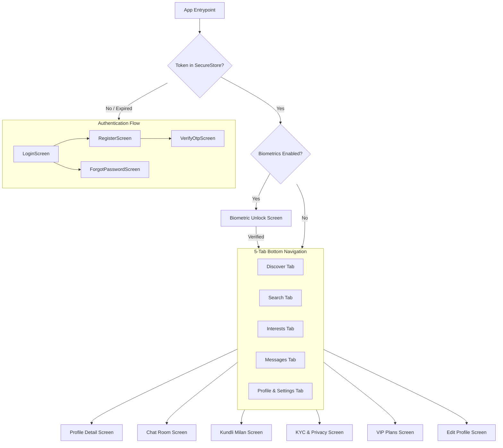

# Vivah Kar Lo — Mobile Application Architecture Document

## 1. Executive Summary & Philosophy
The Vivah Kar Lo mobile application is a production-grade, commercial-quality native mobile solution for Android and iOS engineered with **React Native**, **Expo SDK 52**, and **TypeScript**. 

Rather than creating a disconnected or prototype client, this application directly integrates with the existing Node.js/Express backend, relational/document persistence layer, and security services. It shares data models, validation schemas, and cryptographic standards with the Vivah Kar Lo web platform while adding native mobile capabilities (hardware-backed biometrics, camera/gallery sanitization, push notifications, and over-the-air OTA updates).

---

## 2. Technology Stack & Core Dependencies

| Domain | Technology / Library | Architectural Role |
|---|---|---|
| **Core Framework** | React Native `0.76.6` & Expo SDK `~52.0.20` | Cross-platform native runtime for Android and iOS |
| **Language** | TypeScript `5.3.3` (Strict Mode) | Type-safety, contract enforcement, and maintainability |
| **Navigation** | `@react-navigation/native`, `@react-navigation/bottom-tabs`, `@react-navigation/native-stack` | Native stack transitions, hardware back-button handling, deep-linking |
| **Server State & Cache** | `@tanstack/react-query ^5.60.5` | Stale-while-revalidate caching, optimistic updates, offline resiliency |
| **Client State** | React Context + Native Device Services | Authentication session, user bundle, and active filters |
| **Form Management** | `react-hook-form` + `zod` | Declarative schema validation, input sanitization, minimal re-renders |
| **Secure Key Storage** | `expo-secure-store` | Hardware Keystore (Android) & Keychain (iOS) for JWT/Bearer tokens |
| **Biometric Auth** | `expo-local-authentication` | Face ID / Fingerprint biometric app lock with device passcode fallback |
| **Media & Camera** | `expo-camera`, `expo-image-picker` | In-app selfie capture, KYC document scan, EXIF stripping before upload |
| **Location Services** | `expo-location` | Privacy-conscious coarse location retrieval (City / State matching) |
| **Push Notifications** | `expo-notifications` | Instant match alerts, interest received, and security warning dispatch |
| **OTA Updates** | `expo-updates` / EAS Update | Instant production bug-fix and UI update delivery without App Store resubmission |

---

## 3. Directory & Modular Code Structure

```
mobile/
├── assets/                       # App icons, splash screens, badges, branding
│   ├── icon.png
│   ├── splash.png
│   └── adaptive-icon.png
├── src/
│   ├── constants/                # Colors, Indian matrimonial palette, typography, endpoints
│   │   ├── colors.ts
│   │   └── config.ts
│   ├── services/                 # Hardware, security, storage, and networking layers
│   │   ├── api/
│   │   │   ├── apiClient.ts      # Axios/Fetch wrapper with JWT injection & error handling
│   │   │   ├── authApi.ts        # Login, registration, OTP, duplicate check
│   │   │   ├── profileApi.ts     # Dossier fetch, section updates, photo management
│   │   │   ├── matchingApi.ts    # Smart matching, preferences, recommendations
│   │   │   ├── searchApi.ts      # Multi-criteria queries, saved searches
│   │   │   ├── communicationApi.ts # Express interest, chat threads, messages
│   │   │   ├── securityApi.ts    # KYC upload, privacy rules, 3-strike reporting
│   │   │   ├── kundliApi.ts      # Vedic 36-guna calculation, Manglik dosha
│   │   │   └── membershipApi.ts  # Plans, UPI slip upload, subscription status
│   │   ├── security/
│   │   │   ├── secureStorage.ts  # Hardware Keystore / Keychain token management
│   │   │   └── biometricService.ts # Biometric lock & hardware verification
│   │   ├── media/
│   │   │   └── mediaPickerService.ts # Camera/gallery image picker with compression
│   │   └── updates/
│   │       └── otaUpdateService.ts # expo-updates runtime lifecycle & manual reload
│   ├── navigation/               # Routing hierarchy
│   │   ├── RootNavigator.tsx     # Conditional Auth vs Main App routing
│   │   ├── AppTabsNavigator.tsx  # Bottom tab bar (Discover, Search, Interests, Chat, Profile)
│   │   └── types.ts              # Route param types for type-safe navigation
│   ├── context/
│   │   └── AuthContext.tsx       # Auth lifecycle, user state, and session hydration
│   ├── components/               # Atomic, reusable design components
│   │   ├── common/
│   │   │   ├── Header.tsx        # Royal burgundy header with status icons
│   │   │   ├── Button.tsx        # Saffron/Burgundy primary and outline buttons
│   │   │   ├── Input.tsx         # Clean floating-label text inputs
│   │   │   ├── Card.tsx          # Elevated ivory profile cards
│   │   │   └── Badge.tsx         # Trust badges (Verified, KYC, VIP)
│   │   ├── profile/
│   │   │   ├── ProfileCard.tsx   # Premium matrimonial profile snippet
│   │   │   └── PhotoGallery.tsx  # Protected photo viewer with privacy blur
│   │   └── matching/
│   │       └── KundliScoreBadge.tsx # 36-guna score ring indicator
│   └── screens/                  # Complete user-panel screens
│       ├── auth/
│       │   ├── LoginScreen.tsx
│       │   ├── RegisterScreen.tsx
│       │   ├── VerifyOtpScreen.tsx
│       │   └── ForgotPasswordScreen.tsx
│       ├── main/
│       │   ├── HomeScreen.tsx            # Dashboard overview, analytics & quick actions
│       │   ├── DiscoverScreen.tsx        # Daily recommendations & smart matching feed
│       │   ├── AdvancedSearchScreen.tsx  # Comprehensive filters (Age, Caste, State, etc.)
│       │   ├── InterestsScreen.tsx       # Received, Sent, Mutual & Shortlist tabs
│       │   ├── ChatListScreen.tsx        # Active chat threads
│       │   ├── ChatRoomScreen.tsx        # Safe messaging with scam interceptor
│       │   ├── MyProfileScreen.tsx       # Complete profile view & edit entrypoint
│       │   ├── EditProfileScreen.tsx     # Sectional edit wizard
│       │   ├── PartnerPreferencesScreen.tsx # Desired partner criteria editor
│       │   ├── KundliMilanScreen.tsx     # Vedic 36-guna Ashtakoot calculator
│       │   ├── KycVerificationScreen.tsx # Govt ID & Live Selfie verification
│       │   ├── PrivacySettingsScreen.tsx # Block list, selective field lock, incognito
│       │   ├── MembershipScreen.tsx      # VIP plans & manual UPI payment slip upload
│       │   ├── SupportScreen.tsx         # 24/7 help desk, FAQs & ticket creation
│       │   └── SettingsScreen.tsx        # Password, notifications, biometrics, logout
│       └── detail/
│           ├── ProfileDetailScreen.tsx   # Full matrimonial dossier inspection
│           └── ReportProfileModal.tsx    # 3-Strike community moderation report
├── app.json                      # Expo application metadata & permissions
├── eas.json                      # EAS Build & EAS Update release configurations
├── package.json
└── tsconfig.json
```

---

## 4. Navigation Architecture



---

## 5. Security & Data Flow Integration
1. **API Integration**: All mobile API calls route through `apiClient.ts`, automatically injecting `Authorization: Bearer <token>` fetched from `expo-secure-store`.
2. **Network Resilience**: TanStack Query manages in-memory caching. If the user loses network connectivity, previously viewed profiles and cached lists remain visible, with a non-intrusive offline status banner.
3. **Data Protection**: Sensitive personal information (photos, government IDs) is stripped of GPS EXIF metadata before transmission. Passwords and biometrics are never stored in plain text.
